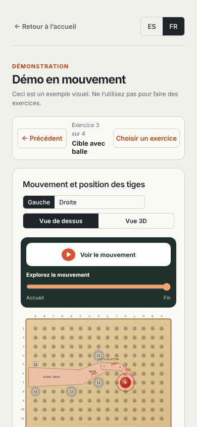
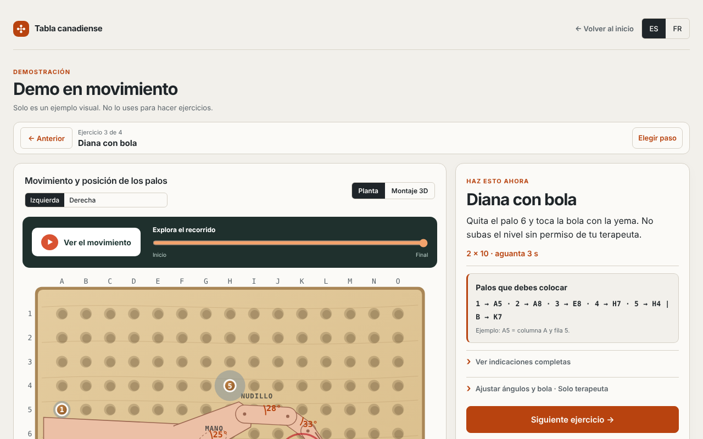

# Table canadienne : le mouvement d’abord

**Application web gratuite qui montre comment l’index bouge sur une planche de rééducation perforée et dans quel trou placer chaque tige.** Le thérapeute prépare la fiche, l’envoie au patient sous forme de code, et le patient voit sa planche montée exactement pour faire les exercices à la maison.

**L’essayer :** [michaelmizu.github.io/tabla-canadiense/?lang=fr](https://michaelmizu.github.io/tabla-canadiense/?lang=fr) · [Versión en español](https://michaelmizu.github.io/tabla-canadiense/)

[Español](README.md) · [Modifications v10 (ES)](CAMBIOS_v10.md) · [Revue UX (ES)](REVISION_UX_v10.md)



> **Important.** C’est une simulation illustrative, **pas une prescription d’exercices**. Les exercices, les angles et la progression sont décidés par le thérapeute de la main ou le chirurgien.

## Le problème résolu

En rééducation de la main, on utilise souvent une **table canadienne** : une planche percée dans laquelle on plante des tiges qui servent de butées. Les tiges maintiennent l’avant-bras et la main, et limitent la flexion ou l’extension d’un doigt. En séance, le thérapeute la monte en une minute. À la maison, le patient ne se souvient plus de la place de chaque tige ni du mouvement exact.

L’application répond à cela de façon visuelle :

- **Elle dessine la planche vue de dessus**, avec la main posée sur la tranche (auriculaire en bas, pouce en haut), les tiges numérotées et le nom de chaque trou (de A1 à O11).
- **Elle anime le mouvement du doigt** pour comprendre l’exercice, et permet de le parcourir pas à pas.
- **Elle traduit la fiche du thérapeute** (angles, répétitions, séries, maintien) en une liste de trous que tout le monde peut monter.

## Pour qui

- **Les patients** qui doivent refaire à la maison des exercices de table canadienne prescrits par leur thérapeute.
- **Les kinésithérapeutes et thérapeutes de la main** qui veulent envoyer une fiche claire, visuelle et reproductible, sans la dessiner à la main.
- **Ceux qui veulent fabriquer la planche** : l’application génère le plan de perçage.

## Utilisation

L’accueil propose trois chemins :

1. **Voir la démonstration.** Ouvre un exemple animé de la série pour comprendre le principe. C’est seulement illustratif.
2. **J’ai une fiche d’exercices.** Le patient colle le code `TABLA1` reçu de son thérapeute et voit sa planche avec les trous, les angles et les répétitions.
3. **Je suis thérapeute.** Donne accès aux mesures de la main, à l’éditeur d’exercices, aux modèles et aux exports.



### La série d’exemple

| Étape | Exercice | Principe |
|---|---|---|
| 1 | Préparation | Chaleur et massage avant de commencer, puis montage des tiges qui tiennent l’avant-bras et la main. |
| 2 | Blocage de la 2e articulation | Une tige sous la première phalange immobilise la MCP : seule l’articulation du milieu fléchit. |
| 3 | Cible avec balle | On touche une balle avec la pulpe. Quand c’est facile, la balle recule d’un trou : progression par niveaux. |
| 4 | Extension jusqu’à la butée | Une tige marque la position de l’ongle doigt tendu, pour vérifier qu’il n’y a pas de perte d’extension. |

Le thérapeute peut modifier cette série, ajouter ses propres exercices et fixer les angles et les doses.

### La fiche à partager

Le thérapeute règle la fiche et clique sur **Copier la fiche**. Il obtient un texte lisible avec les trous et un code `TABLA1` à la fin, à envoyer par message ou par courriel. Le patient le colle dans **J’ai une fiche d’exercices** et l’application reconstruit la planche. Le code contient une somme de contrôle qui détecte les modifications accidentelles. **Il n’authentifie pas le thérapeute.**

## Fonctionnement interne

- **Cinématique 2D** du poignet, du métacarpien et des trois phalanges de l’index, avec mesures réglables, main gauche ou droite.
- **Détection des collisions** entre le doigt, les tiges et la balle.
- **Placement automatique des tiges** sur la grille de trous, avec l’épaisseur de mousse nécessaire pour qu’elles touchent la peau.
- **Niveaux de la cible** : on balaie la flexion du doigt et on classe les trous selon le moment où la pulpe touche la balle.
- **Vue de montage 3D** indicative, avec la hauteur des tiges.

## Fabriquer la planche

| Pièce | Dimensions |
|---|---|
| Planche | Contreplaqué de bouleau de 18 mm, 400 × 300 mm, avec une seconde couche dessous pour des trous borgnes |
| Trous | 165, en 15 colonnes (A–O) et 11 rangées (1–11), entraxe 25 mm. Ø12,2 mm par défaut, ou Ø12,0 mm |
| Tiges | Tourillon de hêtre Ø12 mm, environ 13 cm au-dessus de la planche |
| Mousse | Gaine isolante de tuyau de 80 mm sur les tiges en contact avec la peau |
| Balle cible | Petite balle de Ø30 mm (polystyrène, caoutchouc ou boule de Noël), percée à 12 mm |

L’application exporte le **plan de perçage en SVG à l’échelle 1:1** et en **DXF en millimètres**, prêt pour une CNC, une découpe laser ou à imprimer pour marquer à la main.

## Exports

- **Plan de la planche** en SVG 1:1 et DXF.
- **Fiche PDF A4** d’une page, dans la langue de l’interface.
- **Code `TABLA1`** pour partager la fiche, compatible avec les codes des versions précédentes.

## Langues

L’interface, la démonstration, les étiquettes et le PDF sont disponibles en **espagnol et en français**. Le texte libre saisi par le thérapeute n’est pas traduit automatiquement afin d’en préserver le sens clinique.

Pour partager un lien qui s’ouvre directement en français, ajoutez `?lang=fr` à la fin de l’adresse (ou `?lang=es` pour l’espagnol).

## Utilisation hors ligne

Toute l’application tient dans **un seul fichier**, `index.html`, avec CSS, JavaScript et SVG intégrés. Aucune bibliothèque externe, installation ni compilation. On peut la télécharger et l’ouvrir directement dans le navigateur, sans connexion.

## Sécurité clinique et vie privée

- **Elle ne remplace ni le chirurgien ni le thérapeute de la main.** Elle ne valide ni la phase de récupération, ni la solidité d’une réparation, ni les points de contact réels. La position des tiges et de la mousse se vérifie toujours sur la vraie planche.
- **Chaleur et massage** uniquement sur une cicatrice fermée et sèche, avec l’accord du thérapeute.
- **En cas de** claquement, nouvelle perte d’extension, douleur ou gonflement inattendus, arrêter et consulter l’équipe soignante.
- **Vie privée :** pas de serveur, de compte ni de suivi. Les modèles et la langue choisie restent uniquement dans le navigateur de chaque personne et ne sont pas synchronisés.
- **Ne publiez pas de vraies fiches de patients** dans des dépôts, des tickets GitHub ou sur GitHub Pages.

## Tests

Les dépendances de développement ne font pas partie de l’application web.

```bash
python -m pip install -r requirements-test.txt
python -m playwright install chromium
python tests/smoke.py
```

**54 vérifications automatiques** : animation, pause et curseur de parcours, priorité de la démonstration, affichage mobile, mode mouvement réduit, langue française, compatibilité des fiches et exports SVG, DXF et PDF. Elles tournent à chaque modification avec GitHub Actions. Pour utiliser le Chromium du système, définissez `CHROMIUM_PATH`.

## Publier votre propre copie

1. Faites un fork de ce dépôt ou envoyez les fichiers sur la branche `main` de votre dépôt.
2. Dans **Settings → Pages**, choisissez **Deploy from a branch**, branche `main` et dossier `/(root)`.
3. Après quelques minutes, l’application est disponible à l’adresse GitHub Pages de votre dépôt.

## Contribuer

Les propositions sont les bienvenues, surtout de la part de thérapeutes de la main : nouveaux exercices, autres doigts, améliorations de textes ou traductions. Ouvrez un ticket ou une pull request en expliquant le changement. Toute modification de la logique clinique (angles, ordre de la série, règles de progression) doit être justifiée par des protocoles de rééducation de la main.

## Licence

MIT. Voir [`LICENSE`](LICENSE). Fournie sans garantie d’efficacité clinique.
