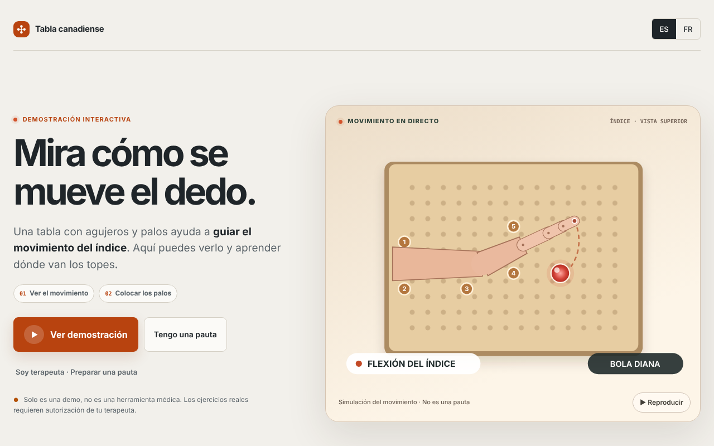
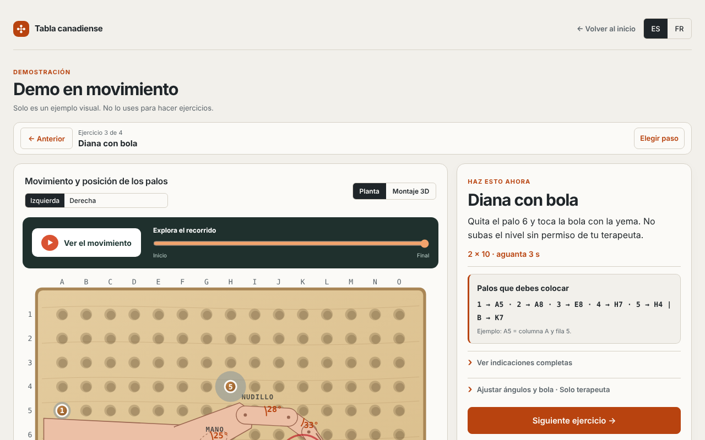

# Tabla canadiense: movimiento primero

**Aplicación web gratuita que enseña cómo se mueve el dedo índice sobre una tabla de rehabilitación perforada y en qué agujero va cada palo.** El fisioterapeuta prepara la pauta, se la envía al paciente con un código y el paciente ve su tabla montada tal cual para hacer los ejercicios en casa.

**Probarla:** [michaelmizu.github.io/tabla-canadiense](https://michaelmizu.github.io/tabla-canadiense/) · [Version française](https://michaelmizu.github.io/tabla-canadiense/?lang=fr)

[Français](README.fr.md) · [Cambios de la v10](CAMBIOS_v10.md) · [Revisión de usabilidad](REVISION_UX_v10.md)



> **Aviso.** Esto es **solo una demo ilustrativa**. **No es un producto sanitario, no es una herramienta médica y no da consejo médico.** No sustituye al médico ni al terapeuta. Los ejercicios, los ángulos y la progresión los decide siempre un profesional sanitario. Consulta el [aviso legal](#aviso-legal).

## Qué problema resuelve

En terapia de mano se usa a menudo una **tabla canadiense**: un tablero con agujeros donde se clavan palos que hacen de topes. Los palos sujetan el antebrazo y la mano, y marcan hasta dónde se dobla o se estira un dedo. En consulta lo monta el terapeuta en un minuto. En casa, el paciente no recuerda dónde iba cada palo ni cómo era el movimiento.

Esta aplicación lo resuelve de forma visual:

- **Dibuja la tabla vista desde arriba**, con la mano de canto (meñique abajo, pulgar hacia arriba), los palos numerados y el nombre de cada agujero (de A1 a O11).
- **Anima el movimiento del dedo** para que se entienda qué hay que hacer, y permite recorrerlo paso a paso.
- **Traduce la pauta del terapeuta** (ángulos, repeticiones, tandas, aguante) a una lista de agujeros que cualquiera puede montar.

## Para quién es

- **Pacientes** que tienen que repetir en casa ejercicios de tabla canadiense pautados por su terapeuta.
- **Fisioterapeutas y terapeutas de mano** que quieren mandar una pauta clara, visual y reproducible, sin dibujarla a mano.
- **Quien quiera fabricar la tabla**: la aplicación genera la plantilla de taladrado.

## Cómo se usa

En la portada hay tres caminos:

1. **Ver demostración.** Abre un ejemplo animado de la serie para entender la idea. Solo es ilustrativo.
2. **Tengo una pauta.** El paciente pega el código `TABLA1` que le ha mandado su terapeuta y ve su tabla con los agujeros, los ángulos y las repeticiones.
3. **Soy terapeuta.** Da acceso a las medidas de la mano, al editor de ejercicios, a las plantillas y a las exportaciones.



### La serie de ejemplo

| Paso | Ejercicio | Qué hace |
|---|---|---|
| 1 | Preparación | Calor y masaje antes de empezar, y montaje de los palos que sujetan antebrazo y mano. |
| 2 | Bloqueo de la 2ª articulación | Un palo bajo la falange de la base deja quieto el nudillo y solo se dobla la articulación del medio. |
| 3 | Diana con bola | Se toca una bola con la yema. Cuando sale fácil, la bola se aleja un agujero: progresión por niveles. |
| 4 | Estirar al tope | Un palo marca dónde queda la uña con el dedo totalmente recto, para comprobar que no se pierde extensión. |

El terapeuta puede cambiar esta serie, añadir ejercicios propios y fijar ángulos y dosis.

### La pauta compartible

El terapeuta ajusta la pauta y pulsa **Copiar pauta**. Sale un texto legible con los agujeros y un código `TABLA1` al final, que puede mandar por WhatsApp o correo. El paciente lo pega en **Tengo una pauta** y la aplicación reconstruye la tabla. El código lleva una suma de comprobación que detecta cambios accidentales. **No autentica al terapeuta.**

## Cómo funciona por dentro

- **Cinemática 2D** de la muñeca, el metacarpiano y las tres falanges del índice, con medidas ajustables y mano izquierda o derecha.
- **Detección de colisiones** entre el dedo, los palos y la bola.
- **Colocación automática de los palos** en la rejilla de agujeros, con el grosor de espuma necesario para que apoyen en la piel.
- **Niveles de la diana**: se barre la flexión del dedo y se ordenan los agujeros según el momento en que la yema toca la bola.
- **Vista de montaje 3D** orientativa, con la altura de los palos.

## Fabricar la tabla

| Pieza | Medidas |
|---|---|
| Tablero | Contrachapado de abedul de 18 mm, 400 × 300 mm, con una segunda capa debajo para que los agujeros queden ciegos |
| Agujeros | 165, en 15 columnas (A–O) y 11 filas (1–11), a 25 mm entre centros. Ø12,2 mm por defecto, u Ø12,0 mm |
| Palos | Varilla de haya de Ø12 mm, unos 13 cm por encima del tablero |
| Espuma | Funda de coquilla aislante de 80 mm en los palos que tocan la piel |
| Bola diana | Bola pequeña de Ø30 mm (porexpán, goma o de Navidad), taladrada a 12 mm |

Desde la aplicación se descarga la **plantilla de taladrado en SVG a escala 1:1** y en **DXF en milímetros**, lista para CNC, láser o para imprimir y marcar a mano.

## Exportaciones

- **Plantilla del tablero** en SVG 1:1 y DXF.
- **Pauta en PDF A4** de una página, en el idioma de la interfaz.
- **Código `TABLA1`** para compartir la pauta, compatible con códigos de versiones anteriores.

## Idiomas

La interfaz, la demostración, las etiquetas y el PDF están en **español y francés**. Los textos libres que escribe el terapeuta no se traducen automáticamente, para no cambiar su sentido clínico.

Para mandar un enlace que se abra directamente en francés, añade `?lang=fr` al final de la dirección, o `?lang=es` para español.

## Abrirla sin internet

Toda la aplicación es **un solo archivo**, `index.html`, con el CSS, el JavaScript y el SVG dentro. No usa librerías externas ni necesita instalación o compilación. Se puede descargar y abrir directamente en el navegador, sin conexión.

## Seguridad clínica y privacidad

- **No sustituye al cirujano ni al terapeuta de mano.** No valida la fase de recuperación, la estabilidad de una reparación ni los puntos de contacto reales. La colocación de palos y espuma se comprueba siempre sobre la tabla real.
- **El calor y el masaje** solo con la herida cerrada y seca, y con autorización del terapeuta.
- **Si aparece** un chasquido, una nueva pérdida de extensión, dolor o hinchazón inesperados, hay que parar y consultar al equipo que te trata.
- **Privacidad:** no hay servidor, cuentas ni seguimiento. Las plantillas y el idioma elegido se guardan solo en el navegador de cada persona y no se sincronizan.
- **No publiques pautas reales de pacientes** en repositorios, incidencias de GitHub ni en GitHub Pages.

## Pruebas

Las dependencias de desarrollo no forman parte de la aplicación web.

```bash
python -m pip install -r requirements-test.txt
python -m playwright install chromium
python tests/smoke.py
```

Son **54 comprobaciones automáticas**: animación, pausa y barra de recorrido, prioridad de la demostración, vista móvil, modo de movimiento reducido, idioma francés, compatibilidad de pautas y exportadores SVG, DXF y PDF. Se ejecutan en cada cambio con GitHub Actions. Para usar el Chromium del sistema, define `CHROMIUM_PATH`.

## Publicar tu propia copia

1. Haz un fork de este repositorio o sube los archivos a la rama `main` de uno tuyo.
2. En **Settings → Pages**, elige **Deploy from a branch**, rama `main` y carpeta `/(root)`.
3. En un par de minutos estará en la dirección de GitHub Pages de tu repositorio.

## Contribuir

Las propuestas son bienvenidas, sobre todo de terapeutas de mano: ejercicios nuevos, otros dedos, mejoras de texto o traducciones. Abre una incidencia o un pull request explicando el cambio. Cualquier cambio en la lógica clínica (ángulos, orden de la serie o reglas de progresión) debe justificarse con protocolos de terapia de mano.

## Aviso legal

Este proyecto es **una demo con fines ilustrativos y educativos**. No es un producto sanitario ni un dispositivo médico, no ha sido validado clínicamente y no ofrece diagnóstico, tratamiento ni consejo médico de ningún tipo.

Se ofrece **"tal cual", sin garantías de ningún tipo**, expresas o implícitas, incluidas la exactitud, la utilidad o la adecuación a un fin concreto. Quien la use, o fabrique o utilice una tabla a partir de ella, lo hace **bajo su propia responsabilidad**. Los autores y colaboradores **no se hacen responsables de ningún daño, lesión o perjuicio**, directo o indirecto, derivado de su uso o de la imposibilidad de usarla.

Ante cualquier duda sobre una lesión o un ejercicio, consulta con tu médico o tu terapeuta.

## Licencia

MIT. Consulta [`LICENSE`](LICENSE).
